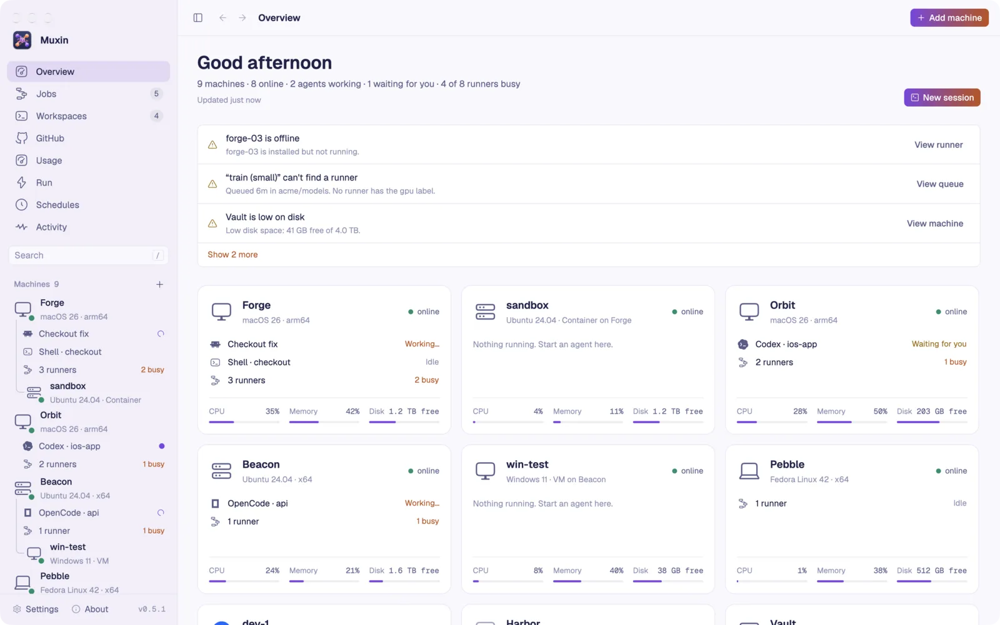

<p align="center">
  
</p>

<h1 align="center">Muxin</h1>

<p align="center">One app for all your machines, run by you <b>or by your AI agents</b>.<br>
<a href="https://muxin.dev">muxin.dev</a> · free and open source (Apache-2.0)</p>

<picture>
  <source media="(prefers-color-scheme: dark)" srcset="assets/readme/overview-dark.webp">
  
</picture>

Point it at the machines you own (a Mac Studio under the desk, a NUC, a Linux box, a few MacBooks, a Windows laptop) and Muxin becomes the hub for all of them:

- **Agent sessions:** Claude Code, Codex, OpenCode, Gemini CLI, Amp, Pi or a shell on any machine, in a real terminal, still running after you close the app.
- **Desktops:** see a Linux machine's screen live and use it, beside an agent's terminal or in its own window.
- **Files and clipboard:** copy files and folders between any two machines, and copy on your Mac to paste on a machine (and back).
- **GitHub:** your inbox, repositories, issues and pull requests, with one click to hand an issue to an agent on the machine you pick.
- **Self-hosted runners:** which runners are working, idle or offline, which jobs no runner can take, and installing, starting, stopping or removing runners.
- **Health:** CPU, memory, disk and uptime, and a plain answer when a machine is offline or unreachable.

Agents can also **borrow a machine as a work environment**: an [agent workspace](#agent-workspaces) is a persistent folder (optionally a git checkout) on one of your machines where an agent runs commands, edits files and syncs code.

- **Native and fast.** The window is built with [GPUI](https://www.gpui.rs), the GPU-accelerated UI framework behind the Zed editor. It runs on macOS, Linux and Windows.
- **Agent-first.** Every capability is available as an MCP server (`muxin mcp`) and as scriptable commands with `--json`. Claude Code, Codex and other agents can check your machines, explain problems and fix them.
- **Uses what you already have.** Machines are first reached with your system `ssh`, so your keys, agent and `~/.ssh/config` aliases just work; after that Muxin talks to its own small agent there, directly or through [Tailscale](#tailscale-and-moving-between-networks). GitHub access uses your `gh` login.

## Install

Download the app from the [latest release](https://github.com/LumaryLabsLLC/muxin/releases/latest):

- **macOS** 12 or later, Apple silicon and Intel: `Muxin-<version>-macos.dmg`. Open it and drag Muxin to Applications. It's signed and notarized.
- **Linux** with glibc 2.35 or newer (Ubuntu 22.04, Debian 12, Fedora 36, openSUSE Tumbleweed, RHEL 10 and later), for Intel and AMD (`x86_64`) or Arm (`aarch64`):
  - Debian and Ubuntu: `Muxin-<version>-linux-x86_64.deb`, then `sudo apt install ./Muxin-<version>-linux-x86_64.deb`.
  - Fedora, openSUSE and RHEL: `Muxin-<version>-linux-x86_64.rpm`, then `sudo dnf install ./Muxin-<version>-linux-x86_64.rpm` (or `zypper install`).
  - Arch: `yay -S muxin-bin` from the [AUR](https://aur.archlinux.org/packages/muxin-bin), or `Muxin-<version>-linux-x86_64.pkg.tar.zst` with `sudo pacman -U`.
  - Any distribution: `Muxin-<version>-linux-x86_64.AppImage`. Make it executable and run it; it needs no FUSE 2.
  - Or `Muxin-<version>-linux-x86_64.tar.gz`: unpack it and run `./Muxin/install.sh`, which installs it for you, no root needed.
- **Windows 11**: `Muxin-<version>-windows-x64-setup.exe`, or `windows-arm64` on Windows on Arm. The installer isn't signed yet, so Windows may say "Windows protected your PC": click **More info**, then **Run anyway**.

Or with [Homebrew](https://brew.sh), on macOS and Linux:

```sh
brew install --cask lumarylabsllc/tap/muxin
```

`SHA256SUMS.txt` in each release has the files' checksums.

Muxin tells you when a new version is out: the sidebar says so, and About shows how to update the copy you have (with Homebrew or the AUR, or the new file to download). It asks GitHub for the latest release when it opens and twice a day; turn that off in **Settings › General › Updates**. `muxin updates` checks from a terminal.

Muxin was called Muxen before 0.5.1. Updating keeps your settings, machines and sessions, and the `muxen` command still works. On a Mac, the old Muxen app goes to the Trash the first time Muxin opens.

### Build from source

```sh
git clone https://github.com/LumaryLabsLLC/muxin && cd muxin
cargo build --release --workspace
./target/release/muxin            # opens the window
```

`--workspace` also builds Muxin's agent for this computer, which the app sets up on it. For your other machines' platforms, `./scripts/build-agents.sh` builds every agent into `dist/agents` (it needs zig and cargo-zigbuild).

Requirements:

- A recent stable Rust (edition 2024).
- On macOS, Xcode (GPUI compiles Metal shaders).
- On Linux, GPUI's system libraries. On Ubuntu/Debian:
  `sudo apt install libxkbcommon-dev libxkbcommon-x11-dev libwayland-dev libvulkan-dev libfontconfig-dev libx11-xcb-dev libxcb1-dev`.

For servers, CI boxes and agent machines there's a headless build with no GUI libraries: just the CLI and the MCP server.

```sh
cargo build --release --no-default-features
```

There's nothing else to set up. Fonts and icons are compiled into the binary.

To run `muxin` from a terminal, use **Settings › General › Command line › Install**, or `muxin shell-command install`. On macOS it links `/usr/local/bin/muxin` to the app (macOS asks for your password when that folder needs it), on Linux `~/.local/bin/muxin`, and on Windows it adds Muxin's folder to your user PATH. `muxen`, its name from before, runs it too. `muxin shell-command remove` takes it out again.

To get a real app with the Muxin icon:

- **macOS:** `./scripts/bundle-macos.sh` builds `dist/Muxin.app`, signed with the Developer ID when it's in your keychain. Drag it to Applications. Agents can still use the binary inside it: `Muxin.app/Contents/MacOS/muxin mcp`.
- **Linux:** `./scripts/package-linux.sh` makes a tarball; its `install.sh` puts Muxin in `~/.local` with an entry in your app menu.
- **Windows:** `scripts\package-windows.ps1` makes the installer.

Releases (a notarized DMG, and for Linux and Windows a tarball and an installer each for Intel/AMD and Arm) are built by GitHub Actions from a version tag: see [RELEASING.md](RELEASING.md).

## Quick start

```sh
muxin --demo                       # explore simulated machines first; nothing real is touched
muxin                              # your machines: starts with this computer in config.toml
muxin add-machine --name "Mac Studio" --host ci@mac-studio.local
muxin watch acme                   # live runner status and jobs for the acme org
muxin install mac-studio --count 2 # two runners, registered with acme, as services
muxin status
```

## The app

- **Overview:** the day in one line (machines online, agents working, runners busy), a few notices for what needs a look (each with a button that fixes or explains it), a card per machine with what's running on it (its agents, desktop and runners) and live CPU, memory and disk, and every agent session across your machines. The Jobs page shows how busy your runners have been over the last few minutes.
- **Machines and runners:** install runners on a machine, and start, stop, restart, show logs for or remove each one. A machine that's off or out of reach says so in plain words (offline, Remote Login off, ssh key not accepted, Tailscale off on this Mac, …), with when it was last seen and what to do; Muxin picks it back up by itself when it returns.
- **Adding machines (⌘N):** suggestions from your `~/.ssh/config`, your Tailscale network, and this network (machines advertising ssh over Bonjour, and Macs that would be addable once Remote Login is on).
- **Agent sessions (⌘T):** a real terminal on any machine running Claude Code, Codex, OpenCode, Gemini CLI, Amp, Pi or a shell. Sessions are listed under their machine in the sidebar (a spinner while the agent works, a colored dot when it wants you), with its open desktop and one line for its runners, and keep running when you close the app. Terminal font size, line height and a blinking cursor are in Settings.
- **Usage (⌃5):** what Claude Code and Codex used on all your machines today or over the last 7, 30 or 90 days, read from their own logs there: tokens and requests by day, model, machine and folder, and what it would cost at Anthropic's and OpenAI's API list prices. With a Claude or ChatGPT plan you don't pay per token; it's what the same use would cost through the API.
- **Run (⌃6):** one command on several machines at once (`df -h /`, `brew upgrade`, `git -C ~/code/api pull`), each one's output side by side as it comes, and its exit status. It runs in your login shell from your home folder; right-click a machine › **Run a command…** to start with just that one.
- **Open in your editor:** sessions, workspaces, GitHub checkouts and Compose projects have a button that lists the editors on this computer (Zed, Cursor, VS Code) and opens their folder in the one you pick, over the editor's own ssh support. Settings › General › Editor picks which comes first (and which `muxin edit` uses).
- **What's running:** a machine's **Services › Processes** lists its busiest processes (CPU, memory, how long they've run, GPU memory on NVIDIA) and stops or kills one; its page shows its GPU (NVIDIA, AMD on Linux, Apple), how busy it is and its memory.
- **Fleet warnings and Wake:** a machine's page and the Overview say when it wants a reboot (Linux updates) or has failed services. A machine that's asleep or off has a **Wake** button (Wake on LAN, sent from this computer and from your machines on its network) once Muxin has seen its network card.
- **Copy files:** a two-pane dialog to copy files and folders from one machine to another (see [Files and the clipboard](#files-and-the-clipboard)); or drop files from the Finder onto a machine in the sidebar.
- **Activity (⌘J):** one timeline of everything happening on your machines: operations started in the app (with live output) and every command agents ran in workspaces, filterable by kind or failures.
- **Workspaces:** see what agents are doing on your machines (every command, its exit code and output), review a workspace's git changes, copy a shell command to step in, or destroy it.
- **Jobs:** queued and running self-hosted jobs, and which queued jobs no online runner can take.
- **Appearance:** follow the system, or pin light or dark, each with its own theme. Built-in themes:
  - dark: Muxin Graphite, macOS Dark, Gruvbox Dark, Catppuccin Mocha / Macchiato / Frappé, Tokyo Night, Nord, Rosé Pine, Solarized Dark, Dracula, Everforest Dark, Kanagawa Wave, GitHub Dark;
  - light: Muxin Paper, macOS Light, Gruvbox Light, Catppuccin Latte, Tokyo Night Day, Nord Light, Rosé Pine Dawn, Solarized Light, Everforest Light, Kanagawa Lotus, GitHub Light.

  The macOS themes also switch to the system fonts (SF Pro, and SF Mono when it's installed). The choice is saved in `config.toml` (`[ui]`).

Keyboard: ⌘P goes to any machine, session or desktop by name, and ⇧⌘P (or ⌘P then `>`) runs any command, including **Theme: Choose…**, which previews each theme as you move through the list · ⌘1…⌘9 go to your machines · ⌃1…⌃6 overview, jobs, workspaces, GitHub, usage, run (Alt on Linux and Windows) · ⌘J activity · ⌘R check machines · ⇧⌘R sync GitHub · ⌘N add machine · ⌘T new session · ⌘F or `/` search your machines and sessions · ⌘B sidebar · ⌘[ / ⌘] back / forward · ⌘, settings. Hold ⌘ to see them in the app, and change them in Settings › Keyboard. On Linux and Windows, use Ctrl instead of ⌘.

## Your settings: `config.toml`

Muxin keeps everything you set in one file, `config.toml`, in `~/.config/muxin/` (`%APPDATA%\muxin\` on Windows), or in `$MUXIN_HOME` if that's set. Run `muxin paths` to see where it is. Older versions kept `fleet.toml`, `settings.json` and `ui.json` in `~/.config/muxen/`; the first run brings them into `config.toml` and leaves the old folder as it was.

- `[[machine]]` tables list your machines. Edit them by hand if you like: Muxin also edits them when you add machines or install runners, and keeps your comments.
- `[settings]` holds the watched GitHub orgs and repos, the polling intervals, whether the clipboard is shared, and cloud machine options.
- `[ui]` holds the app's look: theme, icons, terminal font and size, shortcuts, favorite machines.
- `state.json` holds the last machine check, and what Tailscale last said about each machine.
- `direct.json` holds the machines paired for direct connections, and their addresses.

```toml
[[machine]]
name = "Mac Studio"
host = "ci@mac-studio.local"      # anything `ssh` accepts, or "local" for this computer
runners = ["mac-studio-01", "mac-studio-02"]   # expected runners; missing ones are flagged
# runner_dirs = ["/Volumes/Fast/runners/*"]   # extra places to look (globs)
# shell = "powershell"                          # Windows; auto-detected when omitted
# user = "ci"   port = 2222   ssh_options = ["-i", "~/.ssh/ci"]
# discover = false                              # don't list runners found but not declared
# notes = "Under the desk"
# direct_address = "nas.example.com:47822"      # where a direct connection reaches it (NAT, a forwarded port)

[[machine]]
name = "StudioNAS"   # no runners: shown under "Other machines"
host = "nas"
```

A machine that runs on another one is shown under it: a VM or container reached through that machine (`ProxyJump` to its own address or `127.0.0.1`), or at its address on another port. Muxin works this out from `~/.ssh/config`, what each machine reports about itself (a VM says so), and the Docker containers that publish the port ssh goes to. When it can't be reached, it says whether the machine it's on is off or its container is stopped, and it can start or stop that container (`muxin power win11 on`).

Runners installed in the usual places are discovered automatically: `~/actions-runner*`, `~/actions-runner/*`, `~/runners/*`, `/opt/actions-runner*` and `C:\actions-runner\*`. A runner is found from its `.runner` file and its running `Runner.Listener` / `Runner.Worker` processes.

## GitHub

Watch an org or a repo in Settings, or with `muxin watch acme` (or `acme/api`). Muxin then reads live runner status (online, busy) and the queued and running jobs of the most recently pushed repos.

The token comes from `MUXEN_GITHUB_TOKEN`, `GITHUB_TOKEN`, `GH_TOKEN`, or `gh auth token`. Like `gh`, Muxin sends those variables only to github.com; for GitHub Enterprise Server it uses `GH_ENTERPRISE_TOKEN` or `GITHUB_ENTERPRISE_TOKEN`. Polling uses conditional requests, so unchanged responses don't count against your rate limit.

Reading and registering **org** runners needs an org admin token with the `admin:org` scope:

```sh
gh auth refresh -h github.com -s admin:org
```

Repo runners need admin access to the repo. For GitHub Enterprise Server, set the API URL in Settings or run `muxin settings --api-url https://HOST/api/v3`.

## Use it from AI agents

Muxin ships an [MCP](https://modelcontextprotocol.io) server. Print setup snippets that point at your binary:

```sh
muxin mcp --print-config
```

**Claude Code**

```sh
claude mcp add muxin -- /path/to/muxin mcp
```

**Codex** (`~/.codex/config.toml`)

```toml
[mcp_servers.muxin]
command = "/path/to/muxin"
args = ["mcp"]
```

**Other MCP clients** (Claude Desktop, Cursor, …)

```json
{ "mcpServers": { "muxin": { "command": "/path/to/muxin", "args": ["mcp"] } } }
```

Add `"--demo"` after `"mcp"` to let an agent practice on the simulated machines.

The MCP server has these tools:

| Tool | What it does |
| --- | --- |
| `status` | Counts, GitHub state, every machine, and the `attention` list. Start here. |
| `get_machine` | One machine's resources, runners and diagnostics, with hints. |
| `list_runners` | Runners, optionally filtered by machine or state. |
| `list_jobs` | Queued and running jobs, including which ones no runner can take. |
| `check_machines` | Runs the read-only machine check over ssh now. |
| `add_machine`, `remove_machine`, `rename_machine` | Edit `config.toml`. Nothing on the machine changes, except that `remove_machine` turns off a direct connection from this app. |
| `connect_machine` | Disconnect from a machine (`connected: false`) or connect again. Its sessions keep running there. |
| `machine_ports` | What's listening on a machine: ports, programs or containers, and web servers' page titles. |
| `machine_processes`, `process_signal` | A machine's busiest processes and its GPUs; stop or kill one. |
| `run_on_machines` | Runs one shell command on several machines at once, with each one's output and exit status. |
| `wake_machine` | Wakes a machine that's asleep or off (Wake on LAN). |
| `machine_power` | Powers a machine on or off: a cloud machine, or a VM in a Docker container on another machine. |
| `vm_options`, `vm_create`, `vm_destroy` | VMs on your machines: Windows (Docker with KVM) or Linux containers, added to your machines. |
| `schedule_list`, `schedule_save`, `schedule_delete`, `schedule_run`, `schedule_log` | Commands and agent sessions that run on a machine at set times, run there by its own scheduler. |
| `agent_usage` | What Claude Code and Codex used over the last N days: tokens, requests and cost at API prices, by model and machine. |
| `install_runners` | Downloads, registers and starts runners on a machine. |
| `runner_action` | Starts, stops, restarts or removes a runner, or reads its logs. |
| `get_operation`, `list_operations` | Progress and output of long operations. |
| `github_scopes` | Watches or unwatches orgs and repos, with access checks. |
| `get_settings`, `update_settings` | Settings. |
| `list_ssh_hosts` | Hosts to add: your `~/.ssh/config`, your Tailscale network, and this network. |
| `list_files`, `copy_files`, `cancel_operation` | Browse a folder on a machine; copy files and folders between machines; stop a copy. |
| `machine_connection`, `direct_connection` | How a machine is reached (direct, ssh, which network, Tailscale's view); pair it for direct connections. |
| `desktop_screenshot`, `desktop_input` | Look at a machine's screen (or one monitor of it); click, type and scroll there. |
| `desktop_displays`, `desktop_add_display`, `desktop_remove_display`, `desktop_set_display` | A machine's monitors; add or remove virtual ones, change their resolution or scale. |
| `log_sources`, `logs_read` | A machine's logs: its system log, files, containers and services, and their last lines. |
| `machine_services`, `service_action` | A machine's services, containers, images and Compose projects (with CPU and memory); start, stop, restart, enable or disable one. |
| `docker_run`, `docker_pull`, `compose_action` | Run a container, pull an image, bring a Compose project up or down (or start, stop, restart one of its services). |
| `compose_project` | A Compose project's parts: services, ports, what waits for what, networks, volumes, health. |
| `session_list`, `session_start`, `session_read`, `session_send`, `session_rename`, `session_stop` | Agent sessions on the machines. |
| `session_question`, `session_answer` | What a session's agent is asking (its options), and pick one. |
| `github_inbox`, `github_repos`, `github_repo`, `github_item`, `local_checkouts`, `git_sync`, … | The user's GitHub, and git checkouts on the machines. |
| `workspace_create`, `workspace_list`, `workspace_get` | Check out a machine as a work environment; see what exists. |
| `workspace_exec` | Runs a command in a workspace (or starts it in the background). |
| `workspace_read_file`, `workspace_write_file`, `workspace_list_files` | Work with a workspace's files. |
| `workspace_changes`, `workspace_sync` | Review the git diff; rsync code to or from your local checkout. |
| `workspace_destroy`, `workspace_allow` | Clean up; turn workspaces on or off for a machine. |

Every tool returns structured JSON. Failures come back with a `code` an agent can branch on:

- `not_found`
- `invalid`
- `busy`
- `github`
- `unreachable`
- `operation_failed`
- `internal`

Many failures also include a `hint` with the exact command that fixes them. [AGENTS.md](AGENTS.md) has guidance written for agents.

### The CLI, for scripts and agents without MCP

Every command takes `--json`. In that mode stdout carries JSON only, and errors are printed as `{"error": {...}}`. Progress and logs go to stderr. Exit codes:

- `0`: success.
- `1`: the operation failed.
- `2`: bad input, or the thing wasn't found.

```sh
muxin status [--refresh]                 # overview + what needs attention
muxin machines | machine <id>
muxin runners [--machine <id>] [--state offline]
muxin jobs
muxin add-machine --name <name> --host <ssh-host> [--no-check]
muxin remove-machine <id>
muxin rename-machine <id> <new name>      # the id stays the same
muxin ports beelink                       # what's listening there (web servers first)
muxin forward beelink 3000                # its port 3000 at localhost:3000 here, until Ctrl-C
muxin run --on beelink,mac-studio -- df -h /   # one command on several machines (--all: every one online)
muxin ps beelink [-n 20]                  # its busiest processes and its GPUs
muxin kill beelink 4242 [--force]         # stop a process (--force: SIGKILL)
muxin wake beelink                        # Wake on LAN
muxin power win11 off                     # a VM in Docker on another machine (or a cloud machine): on or off
muxin vm create win-test --system windows-11 --on beelink   # a VM on one of your machines
muxin schedule add beelink --name Tests --every day --at 09:00 --command "make test"
muxin usage [--days 30] [--machine beelink]   # what the agents used, and the cost at API prices
muxin edit beelink:~/code/api [--editor zed] [--print]   # open a folder there in your editor
muxin disconnect <id>                     # stop connecting to it (its sessions go on there)
muxin connect <id>                        # connect again, and check it
muxin install <machine-id> [--scope acme] [--count N | --name a --name b] [--label gpu] [--mode auto|service|background|docker] [--image IMAGE] [--docker-socket] [--no-wait]
muxin runner <start|stop|restart|logs|remove> <runner-id> [--delete-files]
muxin watch <org|owner/repo>... / unwatch ...
muxin settings [--poll 20] [--scan-repos 10] [--check-interval 15]
muxin ssh-hosts                          # ~/.ssh/config, your tailnet, and this network
muxin files <machine>[:<folder>]         # what's in a folder (alias: ls)
muxin cp <machine>:<path>... <machine>:<folder>   # copy between machines
muxin connection <machine> [--direct on|off]
muxin check [--json]                     # one-shot full report
muxin workspace …                        # agent workspaces, see below (alias: ws)
```

Ids:

- Machines are slugs of their names, such as `mac-studio`.
- Runners are `<machine-id>/<runner-name>`, such as `mac-studio/mac-studio-01`.
- A runner that GitHub knows but no machine lists is `github/<name>`.

Every command also accepts `--demo`.

The window, the CLI and MCP servers can all run at once. They share the files in the config directory and pick up each other's changes: settings, edits to `config.toml`, and newer machine checks.

## Agent workspaces

Think of [Amp's Orbs](https://ampcode.com/news/agents-in-orbs), but on your own hardware. An agent asks for a workspace and gets a persistent folder on one of your machines, optionally with a repo cloned at a branch or ref. It then works there like it would on a remote dev box:

- **Run commands** with your login environment (Homebrew, nvm, asdf and the rest of your `PATH`). Long-running things such as dev servers go in the background, with their output in a log file inside the workspace.
- **Read, write and list files.**
- **Review** with `git status` and the diff.
- **Sync code** both ways with your local checkout over rsync: push uncommitted local changes to test them on Linux, pull a fix back.

**Host or Docker.** By default commands run directly on the machine. With `isolation: "docker"` (CLI `--docker`), each workspace gets its own fresh container instead, from an image the agent picks (`node:22`, `python:3.13`, `rust:1`, …; default `buildpack-deps:bookworm`). The workspace folder is mounted at `/workspace`, the container runs as the ssh user so files aren't root-owned, and a container that disappears (reboot, `docker system prune`) is recreated on the next command with the files intact. `docker_socket` shares the machine's Docker for docker-in-docker; that's root-equivalent, so only use it when the task needs it. Docker workspaces need Docker on the machine and the ssh user in the `docker` group. They aren't available on Windows machines yet.

**A worktree of a checkout.** When the repository is already checked out on the machine, a workspace can be a git worktree of that checkout instead of a clone (`worktree_of`, CLI `--worktree-of`): its own folder and branch, sharing the checkout's history, so it's ready in a moment and several agents can work on one repository side by side. New sessions offer it too (**Where › New worktree**), and so does handing an issue to an agent when there's a checkout of its repository. Deleting the workspace removes the worktree and keeps its branch; once the branch's pull request is merged, the Workspaces page offers to clean it up. (A worktree's git history lives in the checkout's `.git` folder, so an agent with a sandbox, such as Codex, asks before it commits there.)

The machine can be named, or picked for you: the least-loaded online machine that allows workspaces, optionally matching a platform such as `linux` or `darwin-arm64`. Private GitHub repos are cloned with your `gh` login; the token is passed through the environment for that one command and never written to disk or logs.

Every command an agent runs is recorded with its exit code, duration and the end of its output. You can see that history in the app's Workspaces page, or open a terminal in any workspace with `muxin workspace shell <id>`.

```sh
muxin ws create --platform linux --repo acme/api --ref main
muxin ws create --docker --image node:22 --repo acme/web   # an isolated container
muxin ws create --machine beelink --worktree-of ~/code/api --branch fix-login   # a worktree of a checkout there
muxin ws exec ws-7f3a2c -- cargo test          # exits with the command's exit code
muxin ws exec ws-7f3a2c --background -- npm run dev
muxin ws cat ws-7f3a2c .muxen/logs/1.log
echo 'hello' | muxin ws write ws-7f3a2c notes.txt
muxin ws files ws-7f3a2c src --depth 1
muxin ws changes ws-7f3a2c
muxin ws sync ws-7f3a2c ~/code/api --push      # or --pull, add --delete to mirror deletions
muxin ws shell ws-7f3a2c                       # an interactive shell in the workspace, for you
muxin ws ls
muxin ws rm ws-7f3a2c [--keep-files]
muxin ws allow studionas --off                 # forbid workspaces on a machine
```

`ws exec` passes the command's stdout and stderr through and exits with its exit code (124 if it timed out), so it composes in scripts. With `--json` it prints the full result instead.

**Safety.** Host workspace commands run as the ssh user on your machine, with that user's permissions; they aren't sandboxed. Use Docker isolation for code you don't trust. Workspaces are on by default for every machine with a host. Turn them off per machine with `workspaces = false` in `config.toml`, the toggle on the machine's page in the app, or `muxin workspace allow <machine> --off`. Nothing is deleted automatically: workspaces stay until you or an agent destroys them. Folders live under `~/muxen/workspaces/<id>` on each machine (`workspace_root` in `config.toml` changes that).

## Your GitHub, and handing issues to agents

The GitHub page is built for the loop of picking an issue, handing it to an agent, and moving on:

- **For you:** pull requests waiting for your review, issues assigned to you, and your open pull requests.
- **Repositories:** everything you own, collaborate on or reach through your orgs, with each one's open issues, pull requests and GitHub Actions runs. Star the ones you work on to keep them at the top, and show the list as one list or grouped by owner (you, then your organizations, then repositories other people shared with you).
- **On your machines:** each machine's agent finds git checkouts in your code folders (`~/Developer`, `~/code`, `~/src`, … add yours in Settings › General › Code folders) and links them to their GitHub repository, with branch, commits ahead/behind and uncommitted changes. Fetch, Pull and Push from there.
- **Fix with agent:** on any issue (or **Review with agent** on a pull request), one click opens a new session in that repository's checkout on the machine you pick (this computer first), with the issue's link, title and description as the agent's first message. Right-click an issue or pull request for **Fix in a new workspace…**: pick any machine and agent, and Muxin clones the repository there (an issue gets its own branch, like `issue-910-content-excalidraw`; a pull request checks out its branch, forks included), then starts the agent in it.

Muxin uses the GitHub CLI's login (`gh auth login`) or `GITHUB_TOKEN`. Settings has a **Sign in with GitHub** button that runs the CLI's browser sign-in; each machine's page shows whether its own `gh` is signed in (agents there use it for issues and pull requests) and can sign it in too.

**Git on each machine.** A machine's page has a Git card: whether its GitHub CLI is signed in, who commits there, and how pushes reach GitHub. When something's missing, one click fixes it: **Use my GitHub identity** sets git's name and email to your GitHub name and private noreply address, and **Use the GitHub CLI** runs `gh auth setup-git` so pushes use the machine's `gh` login. Agents working there can then commit and push.

```sh
muxin git status beelink
muxin git setup beelink --identity --credentials
```

**Permissions.** Watching an organization's runners needs the `admin:org` permission on your GitHub login. Settings shows when it's missing, with a **Grant access** button that runs `gh auth refresh -s admin:org` in a terminal (it finishes in your browser), and lists your organizations so watching one is a click.

**More than one account.** Click your name at the top of the GitHub page to switch. The menu lists every account the GitHub CLI here is signed in to, plus each machine's own `gh` login: with a work laptop signed in to your work account, pick "@you-at-work · Work MacBook" and Muxin sees that account's repositories, inbox and runners (the token is fetched over ssh when needed and kept in memory only). Fix with agent then prefers checkouts on that machine. Switching doesn't change which account `gh` uses in your terminal. "Add another account…" runs `gh auth login`.

```sh
muxin github inbox                         # what needs you
muxin github repos                         # favorites first (★)
muxin github favorite ZenNotes/zennotes    # --remove to unstar
muxin github accounts
muxin github use work-login                # or: --machine work-macbook
muxin github repo ZenNotes/zennotes        # issues, PRs, runs, and where it's checked out
muxin github issue ZenNotes/zennotes#632   # or the issue's URL
muxin checkouts --repo ZenNotes/zennotes
muxin checkouts --machine beelink --path ~/code/api --git pull
```

## Agent sessions

Start an AI agent on one of your machines and come back to it whenever you like, from the app, from your own terminal, or through another agent.

- **Keeps running.** Sessions live in Muxin's agent on the machine (`~/.muxen/bin/muxen-agent`), a small background program that holds each session's terminal, the way tmux would. Closing the app, sleeping your laptop or losing the network only detaches; the agent keeps working until you end the session, and reopening it shows the screen as it is with its recent scrollback. A restart of the machine ends its sessions, as with tmux.
- **Nothing to install.** When Muxin connects to a machine it uploads the agent build for that OS and CPU (macOS, Linux and Windows, x86_64 and arm64; a few MB) and keeps it up to date.
- **Split panes.** ⌘D splits a terminal to the right, ⇧⌘D below it (or the buttons in its header): a new shell on the same machine, in the same folder. ⌥⌘← and ⌥⌘→ move between panes, or click one. Each pane is a session of its own, so it keeps running like any other; type `exit` to close it, or × on its bar to take it out of the split. Splits come back when you reopen Muxin.
- **A real terminal in the app.** Everything goes to the agent: Esc, Ctrl-C, Tab, arrows, Option/Shift+Enter for newlines. ⌘C copies a selection, ⌘V pastes, the wheel scrolls back. Nerd Font icons (Neovim's file icons, prompt glyphs) show with any terminal font: Muxin brings the symbols. Right-click a machine for a new terminal or agent session.
- **Names you choose.** Right-click a machine or a session and pick **Rename…** (or ⇧⌘P › Rename on its page). A machine keeps its id, so its runners, sessions and favorites stay with it; `config.toml` gets `id = "<old id>"` when the new name would give a different one. A session's title is kept by the agent on its machine (`~/.muxen/titles.json`), so every Muxin sees it; an empty title goes back to the one it started with.
- **Your environment.** The agent starts in your login shell, in the folder you pick, so nvm/fnm/asdf and the CLI's own login work as they do in your terminal. Muxin finds which agent CLIs each machine has: `claude`, `codex`, `opencode`, `gemini`, `amp`.
- **What it changed.** Each session shows its branch, the lines and files it changed since the default branch, its commits and uncommitted files, and the branch's pull request with its checks (click it to open it on GitHub). Muxin looks when a session stops working, and at least every minute while sessions run.
- **Actions.** A session's **Actions** button (or its right-click menu) asks its agent to commit, commit and push, open or update the pull request, review the changes, fix the review comments, resolve conflicts or write a recap. Each one types a prompt into the agent; change any of them in **Settings › Prompts** (`[settings.prompts]` in `config.toml`), where `{branch}`, `{base}` and `{pull}` are filled in.
- **Agents can drive agents.** `session_start`, `session_read` (the screen as text), `session_question` and `session_answer` (what it asks, and an answer), `session_send` (type into it), `session_action` and `session_stop` are MCP tools and CLI commands too.

```sh
muxin session ls                                   # every session, and which agents each machine has
muxin session start beelink claude --cwd ~/code/api --prompt "fix the failing test"
muxin session read beelink/claude-3f9a             # what's on its screen
muxin session send beelink/claude-3f9a "yes"       # type, then Enter (--no-enter to skip it)
muxin session do beelink/claude-3f9a pull_request  # an action: commit, commit_push, pull_request, review, fix_comments, conflicts, recap
muxin session question beelink/claude-3f9a         # what it's asking, and the options' keys
muxin session answer beelink/claude-3f9a 1         # pick one
muxin session attach beelink/claude-3f9a           # open it in this terminal; detach with Ctrl-] then d
muxin session restart beelink/claude-3f9a
muxin session rename beelink/claude-3f9a "API server"   # "" goes back to the original title
muxin session stop beelink/claude-3f9a
```

Build the agent for every platform with `scripts/build-agents.sh` (needs `cargo-zigbuild` and Zig for the Linux builds); `scripts/bundle-macos.sh` runs it and ships the builds inside the app.

## Sharing a session or a machine

Show someone a session, or a whole machine, straight from your computer. They join from Muxin or from any browser; nothing to install.

- **Share.** On a session's page, click **Share**: the link is made and copied, ready to paste anywhere (`https://muxin.dev/s#1.…`). By default you let each person in, they can only watch, and it lasts an hour; change any of that in the same window, while it runs: let them type, let anyone with the link watch without asking, or make it last longer.
- **Share a machine.** On a machine's page, **Share** does the same for all of its sessions: guests see the sessions running there (and ones started later) and open any of them. In the same window, share its desktop (**View**, or **Control** for people you let in) and pick which of its servers they can open (**Servers**: what's listening there, web servers first). Everything else stays off: no files, no shell, no other ports.
- **Let people in.** When someone opens it, a card over the page shows their name and a 6-digit code; they see the same code. Ask them to read it out, then **Let in**. A link that leaked shows a code nobody reads to you.
- **While you share.** The header says who's there (**Shared · Sam watching**). Click it to let someone type or stop them, let them use the desktop or stop them, remove them, copy the link, add an hour, or stop sharing. A shared session has an eye in the sidebar; a dot means someone is waiting.
- **Joining.** The link opens a page that asks for their name, then joins right there in the browser (or in Muxin, if they have it). In Muxin, ⇧⌘P › **Join a share…** takes a link too. Shares are listed under **Shared with you**, sessions shown at the size the sharer's terminal is. A shared machine's page lists its sessions, its screen and its servers; **Open** puts a server at `localhost` on the guest's computer (in Muxin; a browser can't open ports).
- **Peer to peer.** The two computers connect directly (WebRTC): over your network or Tailscale when they share one, across the internet otherwise, and through an encrypted relay only when nothing direct works. muxin.dev only introduces them, with two short messages: the part of the link after `#` (the share's secret) never reaches it, and the guest checks that it reached the sharing computer's own certificate, so the site can't listen in or join.
- **What a guest can do.** Only what's shared, and type, use the desktop or open servers only while you let them. Muxin enforces it on your computer, and the agent on the machine attaches a watcher that can't type or resize. Guests never reach the machine itself, its files or a shell.
- **It ends** when its time runs out, when you **Stop sharing**, or when you quit Muxin. The link stops working then, for good.

To introduce them through a server of your own instead (`share-server/` in this repository), set `[settings.share] server = "https://share.example.com"` in `config.toml`.

## Connections and desktops

Muxin first reaches a machine with `ssh`, installs its small agent there, and from then on talks to that agent over **one live connection** instead of a new ssh connection per request: requests take milliseconds instead of ~0.4 s, terminals open instantly, and the sidebar updates the moment a session changes.

- **Over ssh** (the default): one ssh connection per machine, kept open and reconnected when it drops.
- **Direct**: on a machine's page, **Connect directly** pairs the app with its agent (each trusts only the other's certificate, swapped over ssh) and runs the agent's listener as a user service there (systemd or launchd) on UDP port 47821. Muxin then connects over QUIC, falling back to ssh whenever the direct connection is down.
- `MUXEN_NO_LINK=1` turns all of this off: one ssh connection per request, as before.
- **Disconnect** (a machine's right-click menu, or its Connection section) stops all of it for that machine: Muxin closes the connection and stops checking it and reading its sessions, which keep running there. It shows as Disconnected until you **Connect** (its page, its menu, or search). It's kept in `config.toml` as `disconnected = true`.

**Servers.** A machine's page lists what's listening there: web servers first, with their page's title (a dev server, a Docker container's site), then its other ports. **Open** puts one on this computer at `localhost` (the same port number when it's free) and opens it in your browser; no desktop needed. Each connection goes through the machine's live connection, so it works over ssh or direct alike, even for servers that listen only on the machine itself. Open ports are listed under their machine in the sidebar (click to open, × to close) and come back when Muxin starts. **Open a port** takes any port number. From a terminal: `muxin ports <machine>` and `muxin forward <machine> <port>`.

**Desktop.** On a Linux machine with an X11 desktop, a Mac, or a Windows PC someone is signed in to, **Show desktop** (on its page, or its right-click menu) shows its screen live and sends your mouse and keyboard to it. On Linux ⌘ works as Ctrl; on a Mac it stays ⌘. An open desktop is listed under its machine in the sidebar (and keeps streaming while you look elsewhere); close it there.

**Nobody signed in.** Muxin shows the screen of the account it connects as, so that account has to be signed in there. Servers often have nobody signed in, and a Remote Desktop window closed without signing out leaves a session with no screen. Muxin says so right away and offers **Open with Remote Desktop** (Windows), **Open with Screen Sharing** (Mac) or **Open with RDP or VNC** (Linux); the machine's right-click menu has it too. It opens the machine's own remote desktop in your app for it: Windows App or Remote Desktop Connection, Screen Sharing, Remmina or FreeRDP. That shows the sign-in screen, so you can sign in. It goes through Muxin's connection to the machine, so it works away from home too and nothing has to be opened in a firewall. Here it's at `localhost:3390` (VNC: `localhost:5901`), listed under Servers. The machine needs it turned on:

- **Windows:** Remote Desktop, in Settings › System › Remote Desktop (on Windows Server: Server Manager › Local Server). Windows Home can't be reached this way. Windows Server allows two admin sessions at once without extra licenses.
- **Mac:** Screen Sharing, in System Settings › General › Sharing.
- **Linux:** xrdp, GNOME's Remote Desktop, or a VNC server such as x11vnc.

From a terminal: `muxin desktop rdp <machine>` or `muxin desktop vnc <machine>`.

**Monitors, real and virtual.** A machine with more than one monitor gets a picker above its desktop: show one monitor at a time (on Linux, or all of them). **Add monitor** (or **Add virtual monitor…** in the machine's right-click menu) plugs in a monitor that isn't there, the way [DeskPad](https://github.com/Stengo/DeskPad) does on a Mac: pick a name and a size (720p to 4K), and it joins the desktop like a real one, to the right of the others. Windows move onto it, the machine's own tools (System Settings, RustDesk) see it, and while the machine's desktop is open, Muxin lists it under the Desktop item in the sidebar to open it directly. It starts at the main monitor's size and offers every common one (720p to 4K). Above a monitor, pick its resolution, and on Linux desktops that offer it, its scale: 200% makes things twice as big and just as sharp, so a 4K monitor reads like 1080p (the stream is always the screen's own size, so it stays crisp). Right-click a monitor (in the picker or the sidebar) to rename or remove it, and in the all-screens view, click a monitor's name to open it. On Cinnamon each virtual monitor gets copies of the main monitor's panels (menu, clock, dock with the same pinned apps), so it's usable on its own. It stays until you remove it (**Remove monitor**) or the machine restarts. Handy on a machine with no screen (a dummy HDMI plug, a server), or to give an agent a monitor of its own. On a Mac it's a CGVirtualDisplay. On Linux (X11) it's a software dummy plug: Muxin plugs a made-up monitor (at the size you picked) into a video output with nothing connected, and the desktop sets it up like a real one. That takes root, so when sudo wants a password Muxin asks for yours, only then, sends it to sudo over its encrypted connection, and keeps it in memory only until you quit. Nothing is installed.

```sh
muxin desktop displays beelink                     # its monitors (virtual ones marked)
muxin desktop add beelink --size 2560x1440         # another monitor, "Display 2"
muxin desktop shot beelink --display DisplayPort-0 # a screenshot of just that one
muxin desktop set beelink HDMI-A-0 --size 3840x2160 --scale 2  # 4K, things twice as big
muxin desktop remove beelink DisplayPort-0
```

- **Macs** ask once, on their own screen, to allow `muxen-agent` under Privacy & Security › Screen Recording (to see it) and Accessibility (to control it). The screen goes over ssh to the agent's background service in your session there, so no other network permission is needed. Release builds sign the agent with a Developer ID, so the permissions survive updates.

- Pick 720p, 1080p, 1440p, 4K or Native from the bar above it. On a local network it starts at the screen's own resolution, further away at 1080p.
- **Open in window** gives it a window of its own (put it on another screen, or full screen).
- On an agent session's page, **Desktop** shows the machine's screen beside the terminal (drag the divider to resize), to check what the agent did without leaving it.
- The bar says how it travels: direct or over ssh, and on which network (local network, Tailscale, internet). Paired machines are reached on their local-network address first, so a machine at home isn't reached through a VPN.
- Only changed parts of the screen are sent (captured through shared memory, compressed on all of the machine's cores), so a still screen costs nothing.

```sh
muxin connection beelink                  # how it's reached, and how fast
muxin connection beelink --direct on      # pair and connect directly
muxin desktop shot beelink -o screen.jpg
muxin desktop input beelink '[{"type":"click","x":100,"y":200},{"type":"text","text":"hello"}]'
```

AI agents get the same: `machine_connection`, `direct_connection`, `desktop_screenshot` (an image they can look at) and `desktop_input`.

**When the connection drops** (another network, a hiccup, the machine's agent restarting), terminals and the desktop pick themselves back up ("Reconnecting…") instead of stopping. A machine that's shut down is noticed within seconds and shown as offline.

## Tailscale and moving between networks

If [Tailscale](https://tailscale.com) is on your Mac, Muxin uses it to keep machines reachable away from home, with nothing to set up: it only reads Tailscale's status and never changes its settings.

- **Home network first.** A paired machine is tried on its local-network address first, and through its Tailscale address a moment later; the first to answer wins. At home that's the local network; at a café it's Tailscale.
- **Moving.** When your Mac changes networks, connections that no longer work are rebuilt the best way from where you are, and ones that went through Tailscale move back to the local network when you're home again. Open terminals and desktops carry on.
- **ssh too.** If a machine's host only works at home (a local IP in `config.toml` or your ssh config), ssh goes to its tailnet address instead when the usual one doesn't answer.
- **Offline answers.** Tailscale's view tells Muxin when a machine is back, whether Tailscale lost it too, or that Tailscale is off on this Mac (with **Open Tailscale**).
- **The Connection card** says which way it goes (Local network, or Tailscale peer-to-peer or through a relay), whether the machine is on your tailnet, and offers **Set up Tailscale** on Linux machines that aren't (the install command, typed in a shell there for you to run).
- **Adding machines:** the Add machine dialog lists the computers on your tailnet; one added by its tailnet name is reachable from anywhere.

## Logs

A machine's logs, live: **Logs** on its page (or right-click it, or ⌘P › Logs) opens them, and they stay under the machine in the sidebar until you close them.

- **System:** the systemd journal and the kernel's messages on Linux, the unified log on a Mac. Without the `systemd-journal` group Linux shows only your own; Muxin says so.
- **Files:** `/var/log`, `~/Library/Logs`, and log files written lately under your home folder (an app's `storage/logs`, a runner's `_diag`), newest first, or any path you type. Root-only ones are marked.
- **Docker** containers, and running **services** (systemd units, yours and the system's).
- The last 500 lines, then new ones as they're written; a filter, Pause, Follow (scrolling up stops it) and Copy. Errors are red and warnings amber.

```sh
muxin logs beelink --list                          # what there is
muxin logs beelink --unit nginx -n 100             # a service's last lines
muxin logs beelink --file '~/app/storage/logs/laravel.log' --grep error
muxin logs beelink --container postgres --follow   # keep printing (Ctrl-C to stop)
```

If Muxin itself crashes, it writes what happened to `crash.log` in its config folder (`~/.config/muxin`, or `%APPDATA%\muxin` on Windows). The agent on a machine writes to `~/.muxen/crash.log`.

## Services and containers

A machine's services, and its Docker containers: **Services** on its page (or right-click it, or ⌘P › Services). Failed ones come first, then running ones; Find narrows the list.

- **Linux:** systemd services, the system's and your own ("yours"), with whether each starts at boot (click **At boot** to change it). **Start**, **Stop**, **Restart**. The system's take root: when sudo wants your password, Muxin asks for it there, once, and keeps it in memory until you quit.
- **A Mac:** Homebrew's services (`brew services`: Postgres, Redis, nginx, ...).
- **What they use:** CPU and memory for each running service and container; sort by them to find what's busy.
- **Docker, all of it:**
  - **Containers:** run one (image, name, ports, environment, volumes, restart policy, command), start, stop, restart, remove, a shell inside it (a terminal session), its log.
  - **Compose:** each project Docker knows, with **Up**, **Down**, **Restart**, **Pull**, its log, and **Edit** (its compose file in your editor, in a terminal on the machine). **New project** makes `~/compose/<name>/compose.yaml` to start from. Click a project to see it three ways: a **Picture** (its services as boxes, an arrow to what each waits for, green when it waits until that's healthy; the ports each opens on the machine, its networks as colored tags, the files it mounts, its volumes at the right; each box with the image, state, health, CPU and memory), a **List** (the same as a table, with Start, Stop and Restart for each service, then its volumes, mounted files and networks), and its **Logs** (every service's lines in time order, each in its color, with a chip to show one service's).
  - **Images:** pull one, run it, remove it, or remove every unused one.
  - Pulls, runs and Compose up/down run as operations: their output shows as they go, and in Activity.
- Stop, Restart, Remove and Down ask first, and say so when stopping one (ssh, Tailscale, the network) could cut Muxin off from the machine. The log button opens its log in **Logs**.

- **Processes:** the machine's busiest few hundred processes, with CPU (percent of one core), memory, how long each has run and who runs it; **Stop** sends SIGTERM, **Kill** SIGKILL (both ask first). Another user's takes root, as for system services. NVIDIA, AMD (Linux) and Apple GPUs show above the list, with how busy and how much memory.

```sh
muxin services beelink                             # services and containers
muxin services beelink restart nginx
muxin services beelink stop postgres --container
```

## Files and the clipboard

**Copying files.** **Copy files** on a machine's page (or its right-click menu) opens two panes: the machine with the files on the left, where they go on the right, each a folder you can browse. Pick files and folders, pick a folder, copy. Dropping files from the Finder onto a machine in the sidebar opens it ready to send them there.

- Files go through Muxin as a tar stream between the two machines' agents, so the machines never need to reach each other or share ssh keys. Folders come along whole, with permissions and links. Your Mac is a machine like the others, so this uploads and downloads too.
- Files with the same names in the destination folder are replaced; the dialog says so first.
- Progress, speed and **Stop** are in Activity.
- Both ends hold back to what the other can take, so a slow machine doesn't pile data up anywhere.

```sh
muxin files beelink:~/build
muxin cp beelink:~/build/app.tar.gz adibs-macbook-pro:~/Downloads
muxin cp adibs-macbook-pro:~/Projects/site beelink:~/www --no-wait
```

**Shared clipboard.** Turn it on in Settings › Clipboard. Text you copy on your Mac can then be pasted on your Linux desktops, Windows PCs and other Macs, and what you copy there lands on your Mac (and on the other machines). Passwords copied from password managers (marked private on the clipboard) aren't shared. Neither is text a program in a terminal copies. One exception: the app on Linux can't tell which copies on its own computer are passwords.

## Cloud machines

Need a machine you don't have? Muxin can make one in your DigitalOcean account. Connect in **Settings › Cloud** with an API token (kept in the macOS Keychain), the browser sign-in, or `doctl`'s login. Then pick **New cloud machine…** in the Add machine dialog: a name, a region (the nearest is preselected) and a size with its price. Muxin creates the droplet with your user and SSH key, installs what you chose (Docker, git and the GitHub CLI; Node with Claude Code and Codex; Tailscale), and adds it to your machines. Then it's like any other machine: terminals, agent sessions, files, workspaces.

DigitalOcean bills a droplet by the second while it exists, **powered on or off**, up to its monthly price; only destroying it stops the charges. Each cloud machine's page shows its rate, what it has cost this month and since it was created, and what this month comes to if you keep it, with **Power on/off** and **Destroy**. **Settings › Cloud › Usage and cost** adds them up: what you're paying per hour now, this month so far (machines destroyed this month included), the month's total if nothing changes, and your whole DigitalOcean bill this month (when Muxin may read it: sign in again in the browser, or use a token with `billing:read`). Settings › Cloud also says what happens when one sits idle: nothing, a reminder, power off, or destroy, after the hours you choose.

```sh
pbpaste | muxin cloud login --token -   # the token on stdin, not in your shell history
muxin cloud options
muxin cloud create dev-1 --size s-2vcpu-4gb
muxin cloud usage                     # what they cost
muxin cloud destroy dev-1
```

## VMs on your machines

Need a clean Windows to try an installer, or a throwaway Linux? **New VM…** (in the Add machine dialog, the command palette, or a machine's right-click menu) makes one on a machine you already have:

- **Windows** 11, 10, Server 2025 or 2022, in Docker with KVM ([dockur/windows](https://github.com/dockur/windows)) on a Linux machine (x86-64). It downloads Windows and installs it by itself, 15 to 30 minutes the first time, then turns on OpenSSH with your key. Watch the install from its page. It runs unactivated until you enter a key.
- **Linux** (Ubuntu, Debian, Fedora, Alpine or Arch) as a container with ssh, on any machine with Docker, this Mac included. Ready in under a minute. It shares its host's kernel (no systemd).

It joins your machines under the one it runs on, with Muxin's agent: sessions, files, the desktop and workspaces work like anywhere, and a UDP port on its host is forwarded to it, so **Connect directly** works too. **Stop** and **Start** it from its page; **Destroy** deletes its container and disk. Your AI agents can do the same through MCP: make a Windows VM for a test, use it, destroy it.

```sh
muxin vm options                                   # where VMs can run, and what
muxin vm create win-test --system windows-11 --on beelink
muxin vm create scratch --system ubuntu-24.04       # on the machine with the most free memory
muxin power win-test off
muxin vm destroy win-test
```

## Schedules

A schedule runs a command, or starts an agent session, on one of your machines at set times: every few minutes, every hour, every day, weekdays, or some days of the week, in that machine's own time. It's kept on the machine and run by its own scheduler (cron, launchd or Task Scheduler), so it runs even when Muxin isn't open. The **Schedules** page lists them with their last run, runs one now, pauses one, and shows each run's output. An agent schedule ("every morning, go through new issues") starts a session you find under the machine, waiting for you.

```sh
muxin schedule add beelink --name "Disk report" --every weekdays --at 09:00 --command "df -h /"
muxin schedule add beelink --name Triage --every day --at 08:30 --agent claude --prompt "Label new issues in acme/api"
muxin schedule ls
muxin schedule log beelink s-ab12cd
```

## How checks and installs work

- **Checks are read-only.** A small script is sent over `ssh` (`sh` on macOS and Linux, PowerShell on Windows), or run directly for `host = "local"`. It reports CPU, memory, disk, uptime and load, and finds the installed runners, their versions, their services and whether they're running. Checks run on a schedule (every 15 minutes by default) or on request.
- **Installs only happen when you ask.** Muxin checks the machine, gets a short-lived registration token from GitHub, and installs each runner in one of these modes (`--mode` / `mode`, default `auto`):
  - **service:** downloads the latest `actions-runner` for the machine's platform into `~/actions-runner/<name>`, runs `config.sh --unattended`, and installs a service: launchd on macOS (the user must be logged in), systemd on Linux (needs **passwordless sudo** for `svc.sh`), a Windows service on Windows.
  - **docker:** one container per runner, `muxen-<name>`, from GitHub's official image (`ghcr.io/actions/actions-runner:<latest runner version>`, or `--image`). The runner's files live in a named volume of the same name, registration happens in a throwaway container that reads the token from stdin (so it never shows up in `docker inspect` or a process list), and the container runs with `--restart unless-stopped`, so it comes back with the Docker daemon. No sudo needed; the user just has to be in the `docker` group. The runners get the `docker` label, and jobs run in a clean Ubuntu userland. `--docker-socket` shares the host's Docker socket so jobs can use Docker; that's root-equivalent access to the machine, so only use it for trusted workflows.
  - **background:** `run.sh` started with `nohup`; no root needed, but it doesn't come back after a reboot (`--no-service` is the same).
  - **auto** picks service when the machine allows it (macOS, Windows, Linux with passwordless sudo or as root), else docker when Docker is usable, else background, and says which it picked in the operation log.
- **Remove** stops the runner, uninstalls its service (or removes its container) and deregisters it with a removal token. It deletes the folder (or the container's volume) only if you ask.
- Docker runners show up in checks with their container's state; a container that keeps restarting is flagged with the `docker logs` command to look at.
- Registration and removal tokens are masked in all output and never logged.
- `ssh` runs with `BatchMode=yes`, so a machine that needs a password just shows up as unreachable. Make sure `ssh <host>` works with keys first.

## Windows

**Windows machines** are managed like the others, over OpenSSH (Settings › System › Optional features › OpenSSH Server, then key-based login; an administrator account for services and runners). Muxin installs its agent in `%USERPROFILE%\.muxen\bin` and works with PowerShell or cmd as sshd's shell:

- **Sessions** keep running after Muxin closes (ConPTY, in the agent's session server).
- **Desktop and clipboard:** the screen, mouse and keyboard of the account Muxin connects as, while it's signed in; Muxin starts its helper in its session through a one-off scheduled task (no window flashes). With nobody signed in, use **Open with Remote Desktop** (see Desktop above).
- **Pages:** Processes and GPUs, Services (Windows services; "at boot" is the startup type), Servers, Logs (the System, Application and Security event logs, a service's events, files), Usage, Copy files, git, Run (PowerShell), workspaces (sync copies through the agent; it doesn't delete).
- **Checks** report admin rights, Docker, the network card (for Wake on LAN), pending reboots and failed services.
- **Direct connections** run `listen` as a scheduled task at sign-in, with a Windows Firewall rule for the agent.

Not yet on Windows: Docker runners and Docker workspaces, adding virtual monitors.

**The app on Windows** is built on Windows (GPUI compiles its shaders with the Windows SDK's `fxc.exe`): install Rust and Visual Studio's C++ build tools with the Windows SDK, run `scripts/build-agents.sh` on a Mac or Linux (it makes the Windows agent too, with `cargo-zigbuild`), then `scripts\package-windows.ps1` on Windows. That makes `dist\Muxin-<version>-windows-x64-setup.exe` (`arm64` on Windows on Arm: an installer, with [Inno Setup](https://jrsoftware.org/isinfo.php): for this user, no administrator needed, a Start menu entry, optionally `muxin` on the PATH, an uninstaller) and `dist\Muxin-<version>-windows-x64.zip` (`muxin.exe` and its `agents\`). Started from Explorer it shows no console window; from a terminal it's the same CLI as elsewhere. Secrets go in Windows' Credential Manager.

## Develop

```sh
cargo test                 # unit + demo-mode integration tests
cargo run -- --demo        # the window, simulated machines
cargo run -- status --demo --json
```

Source layout:

- `agent/`: the agent that runs on each machine (sessions, the live link, direct connections, desktops, files, clipboard).
- `src/share`: sharing sessions by link (the host's gateway, joining, WebRTC); `share-server/`: the server that introduces the two sides and serves the browser's join page.
- `src/fleet`: the engine and snapshot model; `link.rs` and `direct.rs` (connections), `tailscale.rs` and `engine/roaming.rs` (moving between networks), `files.rs`, `clipboard.rs`, `discover.rs` (machines on this network).
- `src/probe`: machine checks.
- `src/github`: the GitHub API client.
- `src/ops`: installs and runner control.
- `src/fleet/workspaces/`: agent workspaces (host and Docker).
- `src/api.rs`: the agent API.
- `src/mcp.rs`: the MCP server.
- `src/ui`: the GPUI window.

`Cargo.lock` pins `libc` to 0.2.189: GPUI's HTTP client pulls in `xattr` 0.2, which doesn't build on Linux against newer `libc` releases. Don't run a blanket `cargo update` without rebuilding on Linux.

## Contributing

Issues and pull requests are welcome: see [CONTRIBUTING.md](CONTRIBUTING.md). To report a security problem, see [SECURITY.md](SECURITY.md) instead of opening an issue.

## License

Muxin is open source under the [Apache License 2.0](LICENSE), copyright 2026 Lumary Labs LLC (see `NOTICE`). The Muxin name and logo are Lumary Labs' trademarks; the license doesn't cover them.

It includes third-party components under their own licenses, listed in `THIRD_PARTY_NOTICES.md`: the Geist fonts (SIL Open Font License, `assets/fonts/OFL.txt`), the Lucide icons (ISC, `assets/icons/LICENSE.txt`), the Phosphor, Hugeicons and Fluent icons (MIT), the MingCute icons (Apache-2.0) and the Solar icons (CC BY 4.0), with their licenses in `assets/icons/`, GPUI (Apache-2.0) and the Rust crates in `Cargo.lock`.
